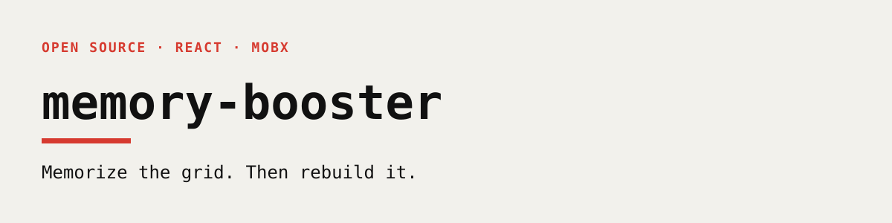
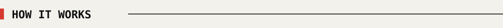

<div align="center">

# Memory Booster



**Look. Remember. Click.** A small memory game for the browser.

[`MIT`](LICENSE) `React 15` `MobX 2`

</div>

<br>


You need Node 20 or 22 (Node 24 crashes on start) and Yarn 1. Paste each line as is.

**1. Get the code:**

```bash
git clone https://github.com/nadimtuhin/memory-booster.git
cd memory-booster
```

**2. Install and start it:**

```bash
yarn install
yarn start
```

Open `http://localhost:3000` and play. The game has 24 levels. Level 1 is a 3x3 grid with 2 gems, and the last is an 8x8 grid with 12.

<br>



**You get a few seconds to look.** The board shows you a grid, then hides it.

**Then you rebuild it from memory.** Each level has a bigger grid and more gems to remember.

<br>


Everything below is reference. This is an older project, built on 2016-era tools (React 15, Webpack 1), so expect old dependency warnings.

A memory card game built with React and MobX. You get a few seconds to memorize a grid of colored blocks, then reproduce it from memory. Each round gets harder.

[](https://github.com/nadimtuhin/memory-booster/actions/workflows/ci.yml)
[](LICENSE)

## Run it

```bash
git clone https://github.com/nadimtuhin/memory-booster.git
cd memory-booster
yarn install
yarn start
```

Opens at `http://localhost:3000`.

## Run tests

```bash
yarn test
```

## Tech stack

- React 15
- MobX 2 (observable state)
- React Router 3
- Webpack 1 (ejected CRA)
- Jest + snapshot tests

## How it works

1. **Memorize** - colored blocks flash on screen for a few seconds
2. **Play** - click every block that was lit, in any order. One wrong click ends the round
3. Level goes up on success. On failure you retry the same level.

## Contributing

See [CONTRIBUTING.md](CONTRIBUTING.md).

## License

MIT
